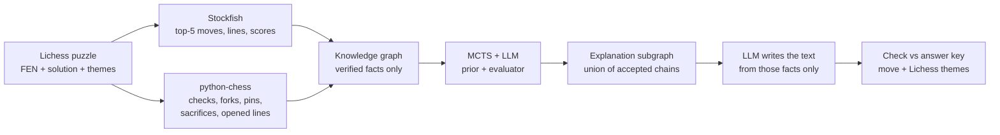

# Chess knowledge graph + LLM-guided MCTS for move explanations

**Live demo (Vercel): [chess-kg-demo.vercel.app](https://chess-kg-demo.vercel.app)** · [How it works](https://chess-kg-demo.vercel.app/pipeline.html) · [Lichess puzzle 2Tl6d](https://chess-kg-demo.vercel.app/puzzle-2Tl6d.html)

Proof of concept for **Project 16, Master Research Project AI (Maastricht University, 2026–27)**:
*LLM-Guided Tree Search for Knowledge Discovery and Explanations in Knowledge Graphs*
(supervisors: Dr. Remzi Celebi and Rishabh Jakhar).

LLMs often say wrong things when they explain chess moves, and they can even propose moves that are not legal.
This prototype makes the LLM explain a move **only through facts that a chess engine and a rules library have verified**.
To decide *which* verified facts make a good explanation, the LLM guides a Monte Carlo tree search over those facts.
The method follows the supervisors' TESSERA paper (LLM-guided MCTS over a knowledge graph, Jakhar, Dumontier & Celebi, 2026),
moved from drug–disease mechanisms to chess.

**Live demo (hosted on Vercel):** <https://chess-kg-demo.vercel.app>
- [Example 1 – a constructed knight fork](https://chess-kg-demo.vercel.app/)
- [Example 2 – Lichess puzzle 2Tl6d, rated 2496](https://chess-kg-demo.vercel.app/puzzle-2Tl6d.html)
- [How it works, step by step](https://chess-kg-demo.vercel.app/pipeline.html), with every LLM prompt and answer of one run

The pages are static: they show recorded runs and do not call any API.

---

## How it works



| Component | Role | Computes moves? |
|---|---|---|
| **Stockfish 19** | Finds the best moves and scores them (text in, text out; no images) | Yes |
| **python-chess** | Detects checks, forks, pins, sacrifices, opened lines and hanging pieces | No, it only checks facts |
| **MCTS** | Tries combinations of facts and keeps those that reach the goal | No |
| **LLM** (`openai/gpt-4.1-mini` via OpenRouter) | **Prior** ("which next fact is worth trying?", 0–10), **evaluator** ("does this chain explain the win?", 0–3), and final writer | No |

### 1. Building the knowledge graph (`chess_kg_engine.py`)

**Search layer, from Stockfish.** Stockfish analyses the position at depth 18 and returns its 5 best moves (MultiPV).
- For each move, the first plies of its principal variation become nodes, linked by `candidate`, `best_reply` and `then` edges.
- Each line ends in an outcome node holding the engine score.
- An outcome is linked to the **goal** node ("decisive advantage") only if the score is at least +3.00 or a forced mate.

**Concept layer, from python-chess.** After each of our moves, exact rules add motif and piece nodes:

| Motif | Rule | Edges |
|---|---|---|
| Check | the opponent's king is attacked | `gives` → check, `answered_by` → the actual reply (the label lists all legal answers) |
| Fork | the moved piece attacks ≥ 2 valuable pieces | `creates`, `targets` |
| Pin (shield) | an enemy piece attacks our moved piece but may not legally capture it, because it is pinned to its king | `exploits`, `targets`, `shields` |
| Sacrifice | the moved piece is taken on the next ply, and this loses material | `makes`, `accepted_by` → the capture |
| Opened line / discovered attack | a slider that did not move now attacks a valuable piece it did not attack before | `opens`, `targets` |
| Hanging piece | a valuable enemy piece is attacked and undefended | `leaves`, `targets` |
| Checkmate | — | `delivers` |

Pieces link forward with `captured_by` to the move that later takes them. Every edge stores its source (Stockfish or python-chess), so **every edge is a verifiable fact**.

### 2. LLM-guided MCTS (`tessera_chess.py`)

The search follows TESSERA:
- **State:** a path from the position node.
- **Candidates:** the out-neighbours of the last node, pre-filtered by personalised PageRank towards the goal (top 8).
- **Prior:** one LLM call ranks the candidates when there are two or more.
- **Value:** one LLM call rates the partial chain on a 0–3 rubric, mapped to [−1, 1]. Reaching the goal gives +1 and a dead end gives −1, with no LLM call.
- **Selection:** PUCT (`Q + 2·P·√N_parent / (1 + N)`).
- **Output:** the union of all paths that reach the goal is the explanation subgraph. A final LLM call turns it into text, using only those facts.

The LLM never decides alone: it only supplies the prior and the value, and the MCTS formula decides where to search next.
With `offline`, the LLM is replaced by uniform priors and a PageRank value, which is the "search without LLM" baseline.

## Results of the recorded runs

| | Example 1: constructed fork | Example 2: Lichess 2Tl6d (2496) |
|---|---|---|
| Graph | 166 nodes, 216 edges | 65 nodes, 95 edges |
| Simulations | 60 | 100 |
| LLM calls (prior / evaluator / writer / baseline) | 11 / 30 / 1 / 1 | 43 / 73 / 1 / 1 |
| Accepted chains | 4 | 7 |
| Correct move in explanation | ✅ Nc7+ | ✅ Ne5+ |
| Lichess themes found | fork ✅ | pin ✅, sacrifice ✅ |
| Board-only LLM (same model, no graph, no engine) | Nc7+, but its explanation misses the queen | **Qh4+, not a legal move** |

In example 2 the accepted chains capture the real idea of the puzzle:
1. Ne5+ *exploits* a pin: the f4 pawn is pinned to its king and cannot take the knight.
2. The sacrifice is *accepted by* Bxe5, which *opens* the d-file.
3. The rook then attacks the queen, which is *captured by* Rxd3+ (+3.86).

LLM answers vary between runs even at temperature 0, so results should be averaged over repeated runs.
In an earlier run (with an earlier version of the graph) the board-only LLM proposed Ne4+, which is also illegal.

## Quick start

Requirements: Python 3.10+, [uv](https://docs.astral.sh/uv/) (or pip), and Stockfish on your `PATH` (`brew install stockfish` on macOS).

```bash
cp .env.example .env            # add your OpenRouter key (only needed for the LLM mode)

# build and print the knowledge graph of a Lichess puzzle (no LLM)
uv run --no-project --with chess,networkx python chess_kg_engine.py 2Tl6d

# LLM-guided search: mode (llm | offline), simulations, optional Lichess puzzle id
uv run --no-project --with chess,networkx,openai,python-dotenv python tessera_chess.py llm 100 2Tl6d
uv run --no-project --with chess,networkx,openai,python-dotenv python tessera_chess.py llm 60      # example 1

# rebuild the web pages from the recorded runs
uv run --no-project --with chess python make_viewer.py 2Tl6d     # -> chess_kg_demo_2Tl6d.html
uv run --no-project --with chess python make_viewer.py llm       # -> chess_kg_demo_llm.html
uv run --no-project --with chess python make_pipeline.py run_2Tl6d.json   # -> site/pipeline.html
```

With pip instead of uv: `pip install -r requirements.txt`, then run the same scripts with `python`.

A run with 100 simulations makes about 120–170 LLM calls (about 40–50k input tokens, roughly USD 0.02–0.03 at gpt-4.1-mini list prices) and takes 2–4 minutes.

## Repository layout

| Path | Content |
|---|---|
| `chess_kg_engine.py` | Engine-built knowledge graph for a Lichess puzzle (Stockfish + python-chess) |
| `chess_kg.py` | Smaller graph for example 1 (material-only alpha-beta instead of Stockfish) |
| `tessera_chess.py` | TESSERA-style LLM-guided MCTS, the board-only baseline and the ground-truth check. It logs every LLM call |
| `make_viewer.py`, `viewer_template.html` | Results page (graph, explanation, MCTS replay) |
| `make_pipeline.py`, `pipeline_template.html` | Step-by-step pipeline page with prompts and answers |
| `puzzles_2500.csv` | 24 Lichess puzzles rated 2450–2560 with ≥ 2 tactical themes (Lichess database, CC0) |
| `run_llm.json`, `run_2Tl6d.json` | Recorded runs used by the pages |
| `site/` | The published static site |

## Limitations and next steps

- **Small scale.** This is a proof of concept on two positions, not an evaluation.
- **The engine supplies the candidates.** The search therefore explains a known answer. In the project plan's *combined design*, candidates are all legal moves, the LLM must find the move itself under a small simulation budget, and Stockfish only verifies.
- **Simple concept detectors.** They cover a few Lichess themes; deflection and zwischenzug, for example, are missing. Representing concepts better is research question 1.
- **Simplified evaluator.** It rates one chain at a time, whereas TESSERA's evaluator compares a path with its rivals.
- **Planned evaluation.** About 300 Lichess puzzles; metrics for correctness, usefulness (masked-move recovery by a reader model), theme coverage, search efficiency and cost; baselines including Kim et al. (NAACL 2025).

## References

- R. Jakhar, M. Dumontier, R. Celebi. *LLM-Guided Monte Carlo Tree Search over Knowledge Graphs: Composing Mechanistic Explanations for Drug–Disease Pairs.* arXiv:2605.09542, 2026.
- J. Kim et al. *Bridging the Gap between Expert and Language Models: Concept-guided Chess Commentary Generation and Evaluation.* NAACL 2025.
- Lichess open database, puzzles (CC0): <https://database.lichess.org/#puzzles>
- Stockfish: <https://stockfishchess.org>; python-chess: <https://python-chess.readthedocs.io>

## Authors

Group 16, Master Research Project AI, Maastricht University:

- Baha Kizil
- Péter Zsula
- Nguyen Thai Binh

Supervisors: Dr. Remzi Celebi and Rishabh Jakhar.
